# Services & Dependency Injection

This document explains how the flow cytometry plugin wires its services together, and documents each service's responsibility, key methods, and dependency relationships. Every claim here is grounded in the actual source under `src/karcytics_plugins/flow_cytometry/`; where a service's true wiring differs from what a "typical" DI setup would lead you to expect, that's called out explicitly.

## 1. The composition root

There is exactly one wiring point: `build_services()` in `ui/composition_root.py`. It builds every service once per panel, in dependency order, and returns them as a frozen dataclass:

```python
@dataclass(frozen=True)
class FlowServices:
    axis_manager: AxisManager
    population_service: PopulationService
    derived_parameter_service: DerivedParameterService
    fluor_service: FluorophoreService
    gate_coordinator: GateCoordinator
    gate_propagator: GatePropagator
    data_loader_service: DataLoaderService
    workflow_service: WorkflowService
    umap_service: UmapService
    workspace_io_handler: WorkspaceIOHandler
    store: FlowStore
    derived_editor: DerivedEditorController


def build_services(state: FlowState, parent_widget: QWidget) -> FlowServices: ...
```

`FlowCytometryPanel` (`ui/main_panel.py`) calls it once in `__init__` and keeps the result as `panel.services`; the builder, the controllers and the Academy read typed fields from it (`panel.services.gate_coordinator`). There is no string lookup and no per-service alias on the panel.

### Why this shape

- **One entry point per panel lifetime.** Services live as long as the panel; nothing re-wires mid-session.
- **The order is the dependency graph.** `build_services()` is straight-line code: a service can only take something built above it, so reading it top to bottom is reading the graph.
- **Typed fields, not keys.** A missing or misspelt service is a type error, not a `None` at run time.
- **The `[phase1]` debug breadcrumbs** show which construction a stalled isolated-process daemon never got past. Keep them when adding a service.

### Construction order

1. `AxisManager(state)` and `PopulationService(state)`, both also set on `state` (`state.axis_manager`, `state.population_service`).
2. `FluorophoreService(CacheManager(~/.karcytics/cache/biology))` and `DerivedParameterService(state)`.
3. `GatePropagator(state, task_scheduler)`, then `GateCoordinator(state, axis_manager, population_service, gate_propagator)`. The coordinator only knows the propagator as `analysis.propagation.Propagation` (request, cross-group request, cleanup); without one, a change stays on its own sample, which is what unit tests use.
4. `DataLoaderService(task_scheduler, call_flow_daemon)`, `WorkflowService(state, data_loader_service, AttachmentManager(axis_manager))`, `UmapService(state, task_scheduler, call_flow_daemon)`.
5. `WorkspaceIOHandler(workflow_service=..., parent_widget=...)`, the undo store `FlowStore(state, CentralEventBus.publish)` and `DerivedEditorController(state, derived_parameter_service, remove_population=gate_coordinator.remove_population, parent=...)`.

`task_scheduler` is the SDK's shared one (`karcytics_sdk.plugin.runtime_services`). `call_flow_daemon` (`ui/services/flow_daemon.py`) is the worker process as a plain callable; see "The worker process" below.

### The worker process

FCS parsing, UMAP and PhenoGraph run in the plugin's long-lived worker process (`analysis/daemon_worker.py`, driven by the SDK's `PluginDaemon`). Analysis code never touches `PluginDaemon`, which is a QObject: it takes an `analysis.daemon_port.DaemonCall`, one blocking call that returns the reply dict.

```python
class DaemonCall(Protocol):
    def __call__(self, method: str, kwargs: dict, *, cancel_poll=None, timeout: float = 120.0) -> dict: ...
```

`fcs_io.load_fcs(path, daemon)`, `load_fcs_batch(paths, daemon)`, `UmapAnalysis(daemon)`, `PhenographAnalysis(daemon)` and `PhenographReclusterAnalysis(run, resolution, daemon)` all take one. The composition root passes `call_flow_daemon`; tests pass `tests.fixtures.daemon.in_process_daemon`, which runs the worker's own handlers in-process (`daemon_worker.dispatch`). `daemon_port` also holds the array wire format (`encode_array`, `decode_array`).

`get_panel_class()` calls `warm_up_flow_daemon()`, which starts the worker on the task pool so the session's first import lands on a warm process.

---

## 2. Service dependency graph

```mermaid
graph TB
    subgraph SDK["Karcytics SDK"]
        TS["task_scheduler<br/>(runtime_services)"]
        PD["PluginDaemon"]
    end

    subgraph Root["Composition Root"]
        BS["build_services()"]
        FD["call_flow_daemon<br/>(ui/services/flow_daemon.py)"]
    end

    subgraph Domain["Domain (analysis/)"]
        AM["AxisManager"]
        PS["PopulationService"]
        FS["FluorophoreService"]
        DPS["DerivedParameterService"]
        GC["GateCoordinator"]
        TE["gating.tree_edits<br/>(module functions)"]
        ATT["AttachmentManager"]
        ST["FlowStore"]
    end

    subgraph UI["UI (ui/services/, ui/controllers/)"]
        WF["WorkflowService"]
        WIO["WorkspaceIOHandler"]
        GP["GatePropagator"]
        DLS["DataLoaderService"]
        US["UmapService"]
        DEC["DerivedEditorController"]
    end

    BS -->|constructs| AM
    BS -->|constructs| PS
    BS -->|constructs| FS
    BS -->|constructs| DPS
    BS -->|constructs, needs AM+PS+GP| GC
    BS -->|constructs, needs TS+FD| DLS
    BS -->|constructs, needs AM| ATT
    BS -->|constructs, needs DLS+ATT| WF
    BS -->|constructs, needs TS+FD| US
    BS -->|constructs, needs WF| WIO
    BS -->|constructs| ST
    BS -->|constructs, needs DPS+GC| DEC

    BS -->|constructs, needs TS| GP
    GC -->|asks to propagate| GP
    GC -->|edits the tree with| TE
    GC -->|submits stats jobs to| TS
    GP -->|submits jobs to| TS
    US -->|submits jobs to| TS
    DLS -->|parses FCS through| FD
    US -->|clusters through| FD
    FD --> PD

    style BS fill:#fff9c4
    style GC fill:#bbdefb
    style TS fill:#f3e5f5
```



---

## 3. Persistence and IO (`ui/services/`, plus `AttachmentManager` in `analysis/`)

### `AttachmentManager` — `analysis/attachment_manager.py`

**Responsibility:** persists binary attachments (currently: UMAP embeddings, indices, and cluster arrays) alongside a saved workflow, separate from the JSON-serializable workflow payload.

```python
class AttachmentManager:
    def __init__(self, axis_manager): ...
    def serialize_attachments(self, state, context) -> dict
    def hydrate_attachments(self, meta_dict, state, context) -> None
    def serialize_umap_results(self, umap_results: dict, context) -> dict
    def hydrate_umap_results(self, meta_dict: dict, state, context) -> dict
```

Depends on `AxisManager` — needed by `_reconstruct_intensities` to re-derive each channel's biexponential (logicle) transform parameters when rehydrating a UMAP run's marker intensities from disk. Numpy arrays are written to/read from `tempfile.gettempdir()` as `.npy` files keyed by generated `emb_key`/`idx_key`/`cls_key` identifiers; the `context` object (an SDK `WorkflowContext`) is what actually persists those temp files into the project's attachment store or a zip. `hydrate_attachments`/`serialize_attachments` are the generic entry points — other attachment types would be registered by extending these two methods (currently only `umap_results` is handled).

**Depended on by:** `WorkflowService` (constructor param).

### `WorkflowService` — `ui/services/workflow_service.py`

**Responsibility:** the QObject that owns save/load of the full flow-cytometry workflow — serializes `FlowState` (experiment tree, compensation, view state) to a dict and back, and orchestrates the async FCS-data reload that must happen after an experiment is deserialized (gate trees can be restored from JSON, but event data has to be re-read from the original `.fcs` files on disk).

```python
class WorkflowService(QObject):
    def __init__(self, state: FlowState, data_loader_service, attachment_manager, parent=None): ...
    def export_workflow(self, context=None, project_dir: Path | None = None) -> dict
    def load_workflow(self, payload: dict, context=None, on_complete=None, project_dir: Path | None = None, **kwargs) -> bool
    def reload_fcs_data(self, sample_paths: dict[str, str], project_dir: Path | None = None, on_complete=None) -> None
```

Depends on `DataLoaderService` (for `reload_samples_batch`, invoked via `reload_fcs_data`) and `AttachmentManager` (for binary payload hydration/serialization). In `__init__` it reaches into `data_loader_service._scheduler` (a private attribute — this is a real coupling, not accidental: `WorkflowService` needs the same `TaskScheduler` to know when its own submitted `FunctionalTask` for FCS reload has finished) and connects to `scheduler.task_finished`.

**Depended on by:** `WorkspaceIOHandler` (passed into `WorkspaceSaveService`/`ZipExportService` static methods), `WorkspaceSaveService`, `ZipExportService`.

### `WorkspaceIOHandler` — `ui/services/workspace_io_handler.py`

**Responsibility:** the top-level "Save"/"Update"/"Load" UI orchestration — decides whether a Karcytics `ProjectManager` is available (project-backed save/load via `WorkspaceSaveService`) or falls back to a standalone `.zip` file (`ZipExportService`), drives the file dialogs, and submits everything as an SDK `FunctionalTask` so the UI thread never blocks on IO.

```python
class WorkspaceIOHandler:
    def __init__(self, workflow_service, parent_widget: Any): ...
    def handle_save(self) -> None
    def handle_update(self) -> None
    def handle_load(self) -> None
```

Depends on `WorkflowService` (constructor param) and, at call time, reaches for `parent_widget.window().project_manager` (an SDK `ProjectManager`, not itself a service the factory builds). Also imports `WorkspaceSaveService` and `ZipExportService` directly (not injected).

**Depended on by:** nothing else in the service graph — it's a leaf, called only from `FlowCytometryPanel`'s save/load menu actions.

### `WorkspaceSaveService` — `ui/services/workspace_save_service.py`

**Responsibility:** pure delegation to the Karcytics SDK's `ProjectManager` — two static methods, `save_to_pm` and `load_from_pm`, that wrap a `WorkflowContext`, call `workflow_service.export_workflow`/`load_workflow`, and drive `pm.save_workflow` / `pm.attach_workflow_file` / `pm.load_workflow_payload`. Stateless; not constructed by the factory (it's a static-method utility class, imported directly where needed).

### `ZipExportService` — `ui/services/zip_export_service.py`

**Responsibility:** the standalone (no `ProjectManager`) persistence path — packs `workflow.json` plus any attachment files into a `.zip`, or extracts one back out to `~/.karcytics/workflows/<stem>/` for loading. Also stateless static methods, not factory-registered.

---

## 4. Scheduling services (`ui/services/`) and domain operations

### `DataLoaderService` — `ui/services/data_loader_service.py`

**Responsibility:** all FCS ingestion and re-application of compensation on reload.

```python
class DataLoaderService:
    def __init__(self, scheduler: object | None, daemon: DaemonCall, plugin_id: str = "flow_cytometry"): ...
    def reload_sample(self, sample, path, compensation_matrix=None) -> bool
    def reload_samples_batch(self, samples_with_paths, compensation_matrix=None) -> dict[str, list[str]]
    def load_samples_async(self, paths, state, on_done, on_error_cb, on_progress=None, project_manager=None, copy_all=False) -> None
```

Depends on the SDK `task_scheduler` (submits an `FCSLoaderAnalysis` worker for `load_samples_async`), on the worker process through its `daemon` (passed to `load_fcs` / `load_fcs_batch` / `FCSLoaderAnalysis`), and on `analysis/compensation.py` (`apply_compensation`).

**Depended on by:** `WorkflowService` (constructor param, used for post-load FCS reload) and `main_panel.py` (raw `.fcs` injection, `panel.services.data_loader_service`).

!!! warning "The worker takes one call at a time"
    `reload_samples_batch` exists specifically because `reload_sample()` → `load_fcs()` serializes through the worker process (`PluginDaemon` takes one call at a time). Calling `reload_sample()` per-sample from a thread pool does **not** parallelize — it collapses into one file at a time, and one slow file blocks every other sample behind it for up to its full IPC timeout. Always prefer `reload_samples_batch` for multi-sample reloads.

### Gate-tree edits — `analysis/gating/tree_edits.py`

**Responsibility:** the pure edits to a sample's `GateNode` tree — `unique_name`, `gates_for_display`, `modify_gate` (with the per-type geometry checks; see [01_API_REFERENCE.md](01_API_REFERENCE.md)), `split_population`, `remove_subtree`, `clone_gate_tree`, `copy_gates_to_group`. Module functions over a `Sample`: no statistics, no event bus, no Qt.

**Depended on by:** `GateCoordinator`, which wraps each edit with the stats recompute, the events, and propagation. Tests and the derived-parameter code call the functions directly.

### `UmapService` / `UmapParams` — `ui/services/umap_service.py`

**Responsibility:** a facade over `TaskScheduler` for background UMAP dimensionality-reduction jobs (`UmapAnalysis` worker) — cancels any in-flight run before submitting a new one, so only one UMAP job runs per `UmapService` instance at a time.

```python
class UmapService:
    def __init__(self, state: FlowState, scheduler: Any, daemon: DaemonCall): ...
    def run_analysis(self, params: UmapParams, on_done, on_error_cb, on_progress=None) -> None
    def cancel(self) -> None
```

Depends on the SDK `task_scheduler` and the worker process (`daemon`, passed on to the UMAP and PhenoGraph analyses), both from `build_services()`.

**Depended on by:** `main_panel.py` (`panel.services.umap_service`).

---

## 5. Central domain objects also built by `build_services()`

| Service | File | Responsibility |
|---|---|---|
| `GateCoordinator` | `analysis/gate_coordinator.py` | The one entry point for changing gates: each operation edits the tree (`gating.tree_edits`), recomputes statistics (submitting `StatisticsAnalysis` to the SDK `task_scheduler`), publishes the change, and asks `GatePropagator` to sync other samples — see [01_API_REFERENCE.md §5](01_API_REFERENCE.md#5-gatecoordinator--analysisgate_coordinatorpy). Exposed as `panel.services.gate_coordinator`. |
| `AxisManager` | `analysis/axis_manager.py` | Per-group channel scale storage + auto-range calculation. See [01_API_REFERENCE.md §6](01_API_REFERENCE.md#axismanager--analysisaxis_managerpy). |
| `PopulationService` | `analysis/population_service.py` | Read-only: sample/node lookup and a population's gated events (`get_gated_events`). Changes go through `GateCoordinator`. |
| `FluorophoreService` / `MarkerService` | `analysis/biology_services.py` | External biology lookups: `FluorophoreService` queries FPbase's GraphQL API for fluorophore spectra (with local disk caching via `CacheManager`); `MarkerService` queries UniProt for CD-marker/protein metadata, falling back to a stub record if the network call fails or returns nothing. |

`GatePropagator` (`ui/services/gate_propagator.py`) (built by the composition root, handed to `GateCoordinator`) is the scheduling half of propagation; which samples a change reaches is the pure `analysis.propagation.propagation_targets(state, source_id, cross_group=...)`. Its responsibility: debounced (200ms) re-application of a source sample's full gate tree to every other sample in scope (active group, or all samples, or explicit cross-group), run on the background `TaskScheduler` via `_PropagationWorker`, publishing `SAMPLE_UPDATED` per sample and `PROPAGATION_COMPLETE` once all targets finish. One bad sample's propagation failure is isolated and reported in `PROPAGATION_COMPLETE`'s `errors` dict rather than aborting the batch.
