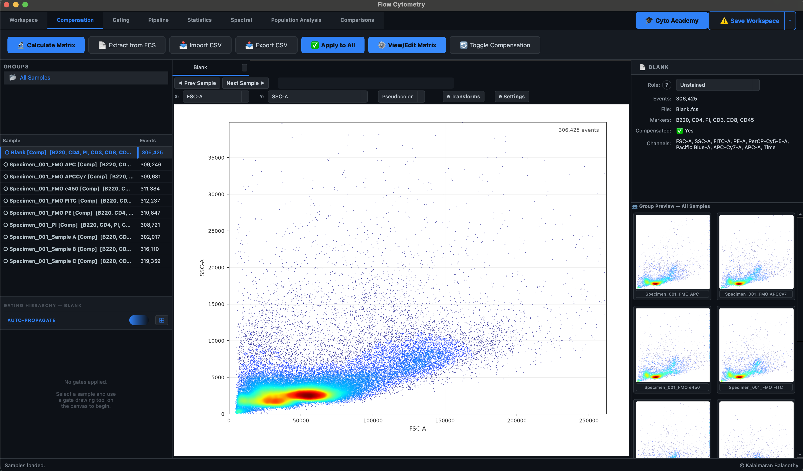
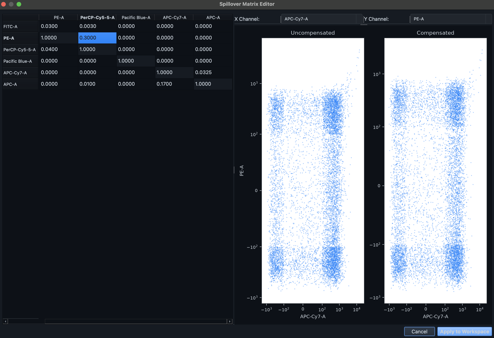

# Compensation

Spectral compensation computationally isolates target fluorophore emissions by mathematically eliminating signal bleed-through from overlapping spectral signatures. The **Compensation** tab provides a robust, algorithm-driven environment for generating, reviewing, and applying high-dimensional spillover matrices.

## 1. Matrix Computation & Extraction

Karcytics provides multiple avenues to obtain a compensation matrix for your dataset:

### Calculate from Controls
Before computation, strict taxonomic roles must be assigned to your control samples within the Workspace Properties Panel (**Unstained Control** and **Single Stain**). The computational engine automatically scans all designated `Single Stain` samples and maps the primary emission channel exhibiting the highest intensity variance.

1. Navigate to the **Compensation** tab.
2. Click **🔬 Calculate Matrix**.
3. The module computes the orthogonal $N \times N$ spillover matrix via linear algebra.

### Extract from FCS Metadata
Many modern acquisition cytometers embed the acquisition-time compensation matrix directly within the FCS file's metadata.

- Click **📄 Extract from FCS** to scan loaded samples for the `$SPILL` or `$SPILLOVER` keyword and automatically load the embedded matrix into your workspace.

### Import from File
If you have computed your matrix using external tools (like FlowJo or R):

- Click **📥 Import CSV** to load a matrix from standard `.csv`, `.tsv`, or `.txt` formats.

## 2. Reviewing the Matrix

Once a matrix is loaded or computed, it is vital to review it for excessive spectral overlap.

1. Open the **Compensation** tab. The matrix editor fills the tab; the buttons at the top get a matrix (**Calculate Matrix**, **Extract from FCS**, **Import CSV**) and act on it (**Export CSV**, **Toggle Compensation**, **Apply to All**). The status line under them shows the matrix's size and source and how many samples it is applied to.
2. Inspect the off-diagonal coefficients. Each **row is a dye** and each **column is a detector**: a cell is the share of the row dye's signal picked up by the column detector. The two cells of a pair (for example FITC → PE and PE → FITC) are separate numbers and are edited independently.
3. Click a cell to plot its pair — its dye on X, its detector on Y. The two cells behind the plotted pair are highlighted, and the note under the matrix says which way each one moves the events.
4. Check the result in the preview on the right, which redraws as you type:
    - **Sample** picks which sample is shown. Judge each cell on the single-stain control for its dye.
    - **Scatter** shows the same events **Before** (raw signal) and **After** (with the matrix as edited), on identical axes. A correctly compensated single-positive population sits level rather than slanting.
    - **Histogram** overlays before (grey) and after (colour) for each of the two channels, which shows whether a negative population has been pushed below zero.
5. Edits are a draft: the status line shows **unapplied edits** and nothing in the workspace changes until you click **✅ Apply to All**, which saves the edits and recompensates every loaded sample. **↩ Revert Edits** discards them. You can leave the tab and come back without losing a draft.

!!! warning
    High spillover values (typically $>50\%$) indicate severe spectral overlap, which may compromise population resolution. If you observe excessive values, consider redesigning your panel or referencing the **Spectral Ribbon** to analyze the physical overlaps.

## 3. Matrix Application

Matrix computation does not destructively alter the raw `.fcs` event data. 

- **Apply to All**: Click **✅ Apply to All** to project the inverted compensation matrix onto your biological datasets. All active visualizations will synchronously refresh to reflect the compensated geometry.
- **Toggle Compensation**: Use the **🔄 Toggle Compensation** button to quickly flip back and forth between raw and compensated states across all samples. This is highly useful for verifying that your matrix has resolved the spectral overlaps without overcompensating (resulting in "bowing" populations).

## 4. Matrix Export

Once verified, the active compensation matrix can be exported by clicking **📤 Export CSV**. This allows you to standardize the matrix for downstream computational pipelines or documentation in publications.
