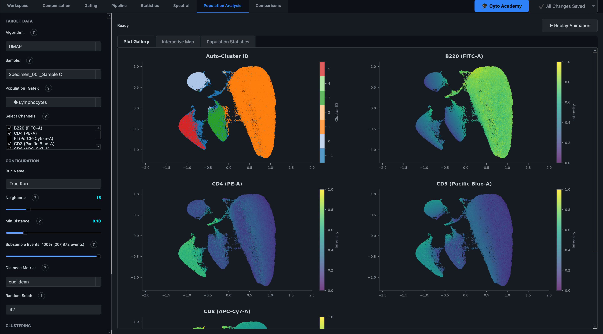
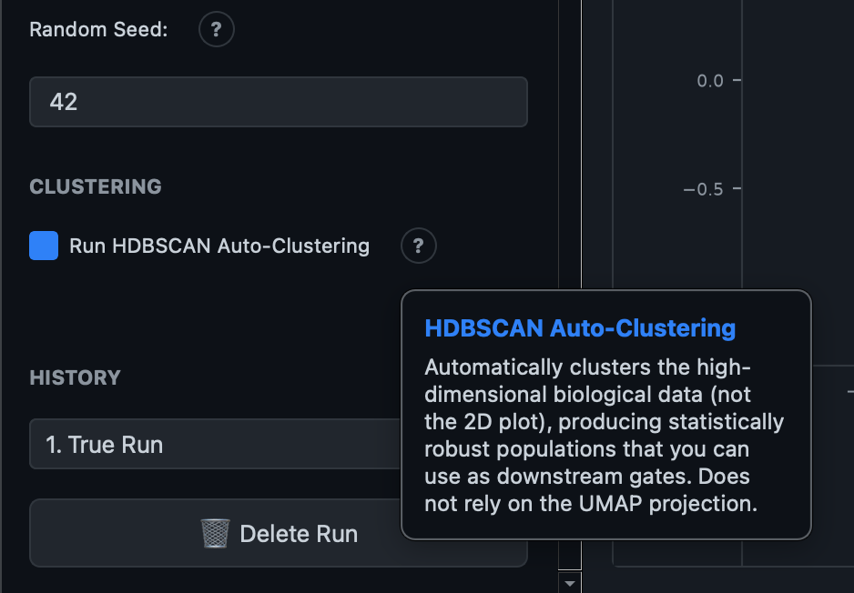
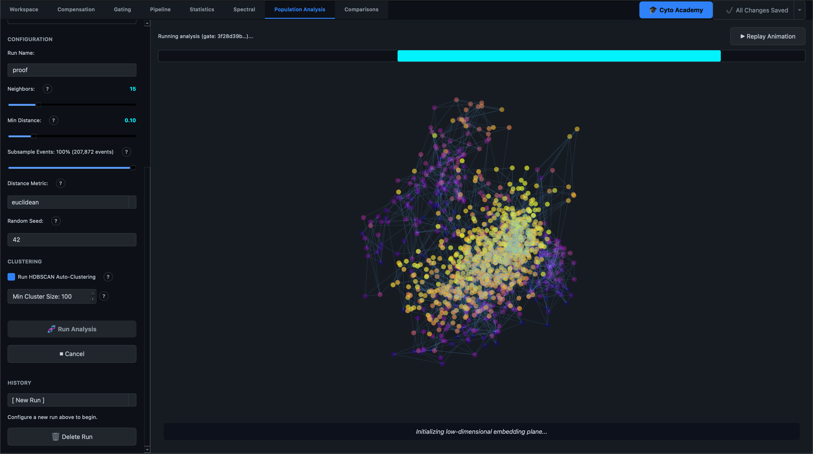
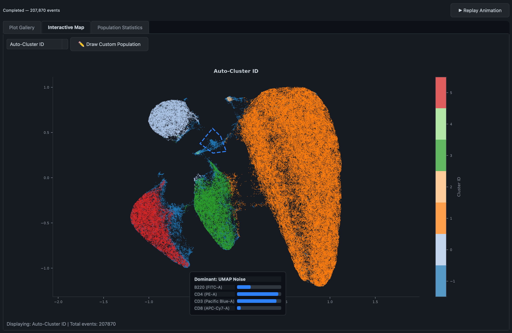
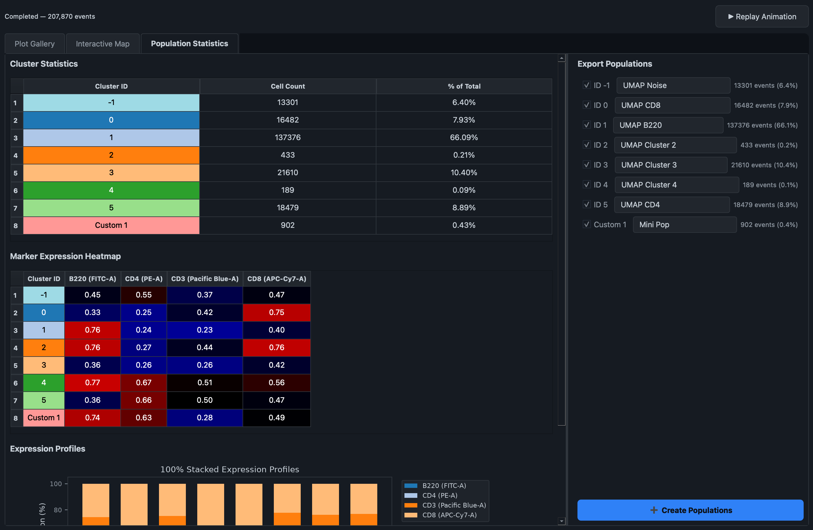

# Population Analysis

The **Population Analysis** tab finds the structure in your data without deciding in advance where the gates should go. It has three methods:

- **UMAP + HDBSCAN.** UMAP (Uniform Manifold Approximation and Projection) takes every marker you measured on a cell and projects it onto a 2D map: cells that look similar across all their markers land near each other. HDBSCAN (optional) then finds dense groups and can leave scattered cells out as noise. Good for exploring continuous gradients and rare sub-populations.
- **FlowSOM** (section 6). Sorts the cells into about 100 small groups of very similar cells, links them into a tree, and groups the tree into *k* populations. Every cell gets a population. Fast enough for every event, and a useful second opinion next to UMAP + HDBSCAN.
- **PhenoGraph** (section 7). Links each cell to its most similar cells and finds groups of cells that link mostly to each other. You set a resolution instead of a number of clusters, and it shows which clusters are pieces of one population and which stand apart.

This tab has no ribbon toolbar. Every control lives in the left panel of the workspace, which mirrors the same layout pattern as Statistics and Comparisons: a fixed sidebar for configuration, and a right-hand workspace for results.

## 1. Configuring a run

### Target data

- **Algorithm** — **UMAP + HDBSCAN**, **FlowSOM** or **PhenoGraph**. The settings below the run name change with it; FlowSOM's are described in section 6, PhenoGraph's in section 7.
- **Sample** — the sample to analyze.
- **Population (Gate)** — optionally restrict the analysis to a specific gated population rather than the whole sample. This is strongly recommended: running UMAP on ungated debris and dead cells distorts the projection, so gating out Live/Singlets first and running UMAP on that population gives a much cleaner map.
- **Select Channels** — the fluorescence parameters fed into the reduction. Uncheck anything already used for gating upstream (viability dyes, scatter parameters) — they add noise rather than useful biological variance to the clustering.

### Run parameters

| Parameter | What it controls |
|---|---|
| Run Name | A label for this run, shown in the Run History dropdown afterward |
| Neighbors | Balance between local and global structure. Lower (5–15) emphasizes fine local clusters; higher (30–50) preserves broader relationships between distant cell types |
| Min Distance | How tightly points are packed in the final layout. Lower values (0.0–0.1) pack similar cells densely, useful for resolving rare or closely related sub-populations; higher values (0.3–0.5) spread points out to preserve topology across major lineages |
| Events used | Percentage of the population's events the run uses, picked at random. UMAP slows down sharply on large data, so 10–20% (its default, 10%) is usually enough. FlowSOM and PhenoGraph default to all events; lower it to compare with a UMAP run on the same share |
| Distance Metric | How "distance" between two cells is measured: **euclidean** (straight-line, general default), **cosine** (angle rather than magnitude — useful if absolute intensity varies due to staining artifacts), or **manhattan** (grid-like, more robust to outliers) |
| Random Seed | Fixes the run's random choices (which events are picked, UMAP's starting layout, FlowSOM's starting nodes, PhenoGraph's neighbour search and grouping), so the same data and settings reproduce the same result. Change it to see another valid result: a quick way to check a finding isn't a fluke |

!!! tip "Why the layout doesn't shuffle every run"
    By default, UMAP implementations start from a randomized layout and can fracture continuous biological gradients (like a maturation trajectory) into disconnected artifacts purely from that random start. Karcytics always initializes the projection from PCA instead — this is not a user-configurable setting — so the overall orientation of the map stays stable across repeated runs and different sample sizes, and continuous gradients render as one continuous shape rather than being torn apart by chance.

### Auto-clustering (HDBSCAN)

Check **Run HDBSCAN Auto-Clustering** to automatically detect density-based clusters in the data at the same time as the UMAP projection. This is a real, working feature — not a planned addition — and it clusters the actual high-dimensional marker data (not the 2D plot coordinates), so the clusters it finds reflect genuine biological similarity rather than an artifact of how UMAP happened to lay points out on the page.

Set **Min Cluster Size** to control how many cells are required before a group counts as a real cluster; smaller values find rarer populations but risk over-segmenting the data, larger values merge small groups together or label them as noise.

## 2. Running the analysis

Click **Run Analysis** to start. Both the projection and (if enabled) the clustering run in the background, so the interface stays usable while a large computation is in progress. Progress is shown as a percentage bar above the results area, and **Cancel** stops an in-flight run.

## 3. The educational animation

The moment you click Run Analysis, a roughly 25-second 3D animation plays automatically in the results area, illustrating what UMAP is actually doing to your data. It runs on a lightweight subset of events purely for visual clarity — it does not block or slow down the full, accurate analysis running concurrently in the background, which continues independently and takes over once both finish.

The animation moves through five phases:

1. **Mapping cells in high-dimensional marker space** — a rotating 3D view of cells positioned by their raw marker values.
2. **Building a fuzzy topological graph of nearest neighbors** — connecting lines fade in between each cell and its nearest neighbors, visualizing the graph UMAP builds internally.
3. **Initializing the low-dimensional embedding plane** — the 3D cloud morphs down toward a flat starting layout.
4. **Optimizing the layout** — points are pulled together if they're connected in the graph and pushed apart if they're not, gradually resolving into the final shape.
5. **Final UMAP manifold** — the completed 2D layout holds in place.

Once the animation ends, the workspace automatically switches to the real results. You can replay the animation at any time afterward with the **Replay Animation** button in the results toolbar.

## 4. Reading the results

### Plot gallery

The first results tab is a gallery of scatter plots on the same UMAP coordinates: one plot per channel you included, coloured by that channel's expression intensity, plus an **Auto-Cluster ID** plot (coloured by discrete cluster membership) if HDBSCAN was run. This is the fastest way to see which region of the map corresponds to which marker — a bright patch on the CD4 plot lining up with a bright patch on CD3 tells you where your CD4 T-cells sit on the map.

Right-click any plot to **copy the image to the clipboard** — useful for quickly dropping a figure into a slide deck or lab notebook.

### Interactive Map (HDBSCAN runs only)

When clustering was run, a second tab lets you explore one plot at a time — switch the colouring between Auto-Cluster ID or any individual marker via the dropdown. Hover anywhere on the plot to see a small floating panel reporting the mean expression of every marker across the 50 nearest neighboring cells at that point — a quick way to probe what's biologically distinctive about a specific region without leaving the plot.

You can also **draw a custom population** directly on this plot: click **Draw Custom Population**, click to place polygon vertices around a region of interest, and press Enter or double-click to close the shape. Cells inside the polygon are pulled out into their own named population (and removed from whichever auto-cluster they belonged to), letting you correct or refine HDBSCAN's boundaries by eye.

### Population Statistics (HDBSCAN runs only)

The third tab summarizes every cluster (auto-detected and custom-drawn) as a table of cell counts and percentages, a marker-expression heatmap per cluster, and a 100%-stacked bar chart of relative marker expression across clusters — a fast way to see which markers define each cluster at a glance.

On the right, each cluster has a checkbox and an editable name field. Rename clusters to something biologically meaningful (e.g. "CD4 Effector Memory" instead of "Cluster 3"), then click **Create Populations** to export the checked clusters into your gating hierarchy as real gates, nested under a new **"UMAP Reduction"** parent node in the Pipeline. From there they behave like any other gate — you can compute statistics on them, or gate further within them.

!!! tip
    Exporting clusters as gates is a one-way bridge from data-driven discovery back into your structured gating strategy — it's the intended way to turn "UMAP found something interesting here" into a population you can report statistics on and compare across samples in the Statistics or Comparisons tabs.

## 5. Run History

Every completed run — its parameters, embedding, and cluster results — is saved automatically to the **History** dropdown, scoped to the specific sample and gate it was run on (running UMAP on a different population keeps a separate, parallel history). Selecting a past run restores its exact configuration in read-only form and redisplays its results, so you can compare how different neighbor/min-distance settings behaved without losing earlier work. **Delete Run** permanently removes a run from history.

## 6. FlowSOM

FlowSOM is the clustering method most used in cytometry. It works in three steps:

1. **Nodes.** The cells are sorted into a grid of small groups of very similar cells, called nodes (10 × 10 = 100 by default). Every cell belongs to one node; none is left out.
2. **Tree.** Each node is linked to the nodes most like it. The result is a tree whose branches are families of related cells, often a lineage or a maturation gradient.
3. **Metaclusters.** The nodes are grouped into *k* metaclusters, FlowSOM's populations. Every cell gets the metacluster of its node.

### Settings

| Setting | Default | What it controls |
|---|---|---|
| Grid size | 10 (100 nodes) | More nodes show finer detail and rarer cells; 100 suits most panels |
| Metaclusters (k) | 10 | How many populations to group the nodes into: roughly how many cell types you expect. You can change it after the run |
| Training passes | 10 | How many times the grid learns from the cells; more rarely changes the result |

A million events take a few seconds, so FlowSOM uses every event of the population by default.

### Reading the FlowSOM Tree

A FlowSOM run opens on the **FlowSOM Tree** tab. Each circle is a node, sized by its cell count; lines join similar nodes. Only the connections matter: positions, rotation and line lengths mean nothing.

Read it the way scientists do:

1. **Colour by each marker** (the *Colour by* menu). Which branches are bright for CD3, which for B220? This is like reading several gating plots at once. The colour scale runs from the dimmest node to the brightest, so small differences show.
2. **Name each metacluster from its phenotype.** The legend gives each one its share of cells and a phenotype such as *B220+ CD3− CD4− CD8lo*, and the **phenotype heatmap** below it shows the same for every marker at once. Per marker, the dimmest metacluster is −, the brightest +, and *lo* is in between; markers that barely differ between metaclusters are left out. *CD3+ CD4+* is CD4 T cells, *B220+ CD3−* B cells, and so on.
3. **Check k.** Good metaclusters follow the branches. One branch split into several colours (or several metaclusters with the same phenotype) means *k* is probably too high; one colour across unrelated branches, too low. Change **Metaclusters (k)**: the tree, the gallery, the map and the statistics update instantly.

Hover a node to see its cell count and its metacluster's phenotype.

!!! note "The other result tabs"
    FlowSOM has no per-cell map like UMAP's, so the **Plot Gallery** and **Interactive Map** draw each cell around its node in the tree. **Population Statistics** and **Export** work as for HDBSCAN; exported populations are named *Metacluster N* under a *FlowSOM* population.

!!! tip "Which method?"
    Run more than one: see the comparison at the end of section 7. Where methods agree, you can trust it more. The [Sample Lens](./16_SAMPLE_LENS.md) checks your gates against any of them, and says when other runs agree.

## 7. PhenoGraph

PhenoGraph (Levine et al., 2015) is graph-based clustering, widely used for mass and spectral cytometry. It works in three steps:

1. **Neighbours.** Each cell is linked to its *k* most similar cells (30 by default), measured across all the run's markers.
2. **Shared neighbours.** Two cells are linked more strongly the more of those neighbours they share. Cells inside one population share most of them; cells on either side of a gap share almost none.
3. **Clusters.** The Leiden method finds groups of cells that link mostly to each other. The **resolution** sets how fine the groups are; you don't choose how many there will be.

### Settings

| Setting | Default | What it controls |
|---|---|---|
| Neighbours (k) | 30 | How many neighbours each cell links to. Lower finds smaller, finer groups; higher merges small groups into larger ones. 30 is PhenoGraph's own default |
| Resolution | 1.0 | How finely the cells are divided. Higher gives more, smaller clusters; lower merges them. You can change it after the run |
| Minimum cluster size | 10 | Smaller clusters are not kept; their cells are marked as outliers |

On 200,000 events a run takes about 15 seconds; changing the resolution afterwards, a few. Above 250,000 events, the graph is built on 250,000 of them and every other cell takes the cluster of its nearest graph cells, which keeps memory in check. The run happens in the background process, so the window stays responsive.

### Reading the Cluster Graph

A PhenoGraph run opens on the **Cluster Graph** tab. Each circle is a cluster, sized by its cell count. A line joins two clusters whose cells are each other's neighbours, and the thicker the line, the more of the smaller cluster's links go to the other. Positions only keep linked clusters close.

1. **Look at the families.** Clusters joined by thick lines are usually one population split along a gradient (a marker that rises gradually, a maturation stage). PhenoGraph does this to large populations, especially at a high resolution.
2. **Look for clusters that stand apart.** A circle with no lines links to no other cluster: a distinct group, often small. The legend and the title say *stands apart*. It is worth a look: it can be a rare population, or something that isn't a cell type at all, such as two cells stuck together (a doublet). Its phenotype is the first clue; a singlet plot (FSC-H against FSC-A) is the usual check.
3. **Colour by each marker and name the clusters** from their phenotype in the legend and heatmap, as for FlowSOM.

Change **Resolution** to merge or split clusters. The graph, gallery, map and statistics update when the re-clustering finishes ("Re-clustering…" beside the control meanwhile).

Hover a circle to see its cells, its phenotype and the clusters it links to most.

!!! note "The other result tabs"
    Like FlowSOM, PhenoGraph has no per-cell map, so the **Plot Gallery** and **Interactive Map** draw each cell around its cluster. Exported populations are named *PhenoGraph Cluster N* under a *PhenoGraph* population.

### Three methods side by side

| | UMAP + HDBSCAN | FlowSOM | PhenoGraph |
|---|---|---|---|
| Cells left out | Yes: sparse cells are noise | None | Only clusters under the minimum size |
| You choose | Minimum cluster size | *k*, the number of metaclusters | Resolution |
| Change it after the run | No (run again) | Yes, instantly | Yes, in a few seconds |
| Events | 10–20% (UMAP slows down) | All, even a million | All (graph on up to 250,000) |
| Its own view | The UMAP map | The node tree | The cluster graph |
| Good at | Seeing gradients and shapes | Speed; lineages along branches | Rare, distinct groups; which splits are real |
| Watch out for | Rare cells dropped as noise | Splits at a high *k* | Large populations split along gradients |
